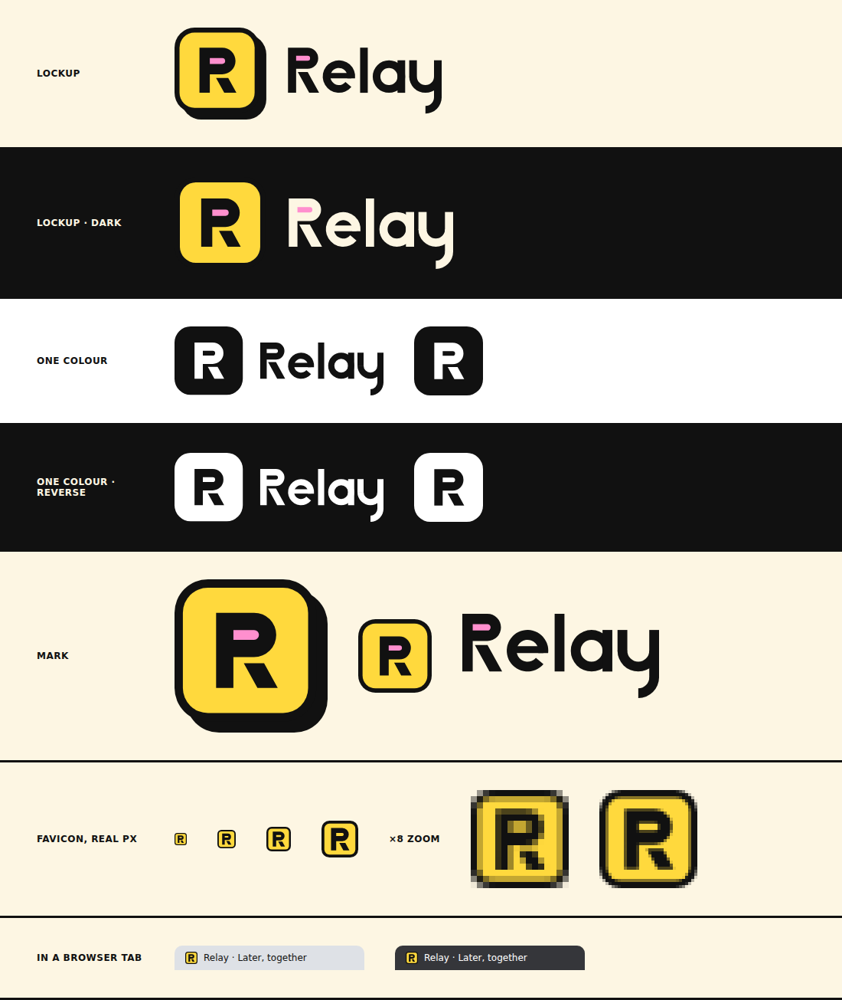

# Relay brand



## The mark

An **R built as a time capsule**. The bowl is the sealed capsule and its counter is a **closed slot**, the letterbox a contribution drops through. The leg **stands apart** from the bowl: it is the part that leaves later, on the release date. The R sits in the yellow tile with the ink border and hard offset shadow the web client already uses (frontend.md: the logo tile, `.neo`).

Every file is filled vector paths: no strokes, fonts, gradients, masks or embedded images. That means the files scale cleanly and look the same in browsers, Figma, Illustrator and print tools.

## Files

| File | Use |
|---|---|
| `relay-lockup.svg` | Primary: tile with shadow + wordmark, on cream or white |
| `relay-lockup-dark.svg` | On dark backgrounds (flat tile, cream wordmark) |
| `relay-lockup-black.svg` / `-white.svg` | One colour: print, embossing, single-colour merch, overlays |
| `relay-mark.svg` | Mark with shadow: avatars, app tiles, social profiles |
| `relay-mark-flat.svg` | Mark without shadow, for nesting inside another bordered object |
| `relay-mark-black.svg` / `-white.svg` | One-colour mark; the R is cut out, so the background shows through |
| `relay-favicon.svg` | Tuned for 16–48 px: heavier border, larger R, no shadow |
| `relay-wordmark*.svg` | Wordmark alone (ink, black, white, cream) |
| `favicon.ico`, `png/` | Raster exports: favicon 16/32/48, Apple touch 180, PWA 192/512, mark 1024, lockups 1200 wide |

## Colour

| Name | Hex | Role |
|---|---|---|
| Yellow | `#FFD93D` | Tile. The brand colour |
| Ink | `#111111` | Letterforms, border, shadow |
| Pink | `#FF8FCE` | The sealed slot, in colour versions only |
| Cream | `#FDF6E3` | Page ground; wordmark on dark |

## Rules

- **Clear space:** at least the height of the R's bowl on every side of the lockup (about 30% of the tile).
- **Minimum size:** the tile at 16 px, using `relay-favicon.svg`; the lockup at 96 px wide.
- **Don't:** recolour the tile, reconnect the leg to the bowl, fill or open the slot differently, add gradients or soft shadows, stretch, rotate, or set the wordmark in a font.
- On photos or busy backgrounds, use a one-colour version.

## Regenerate

The geometry lives in `scripts/brand.ts`. Change it there, never in the SVGs.

```bash
pnpm brand       # brand/*.svg, plus apps/web/public/brand/ and apps/web/app/icon.svg
pnpm brand:png   # brand/png/*, brand/favicon.ico, brand/preview.png, apps/web/app/{favicon.ico,apple-icon.png}
```

The mark was drawn for this project and checked by eye against well-known R marks. No trademark search has been run: do one before registering it.
